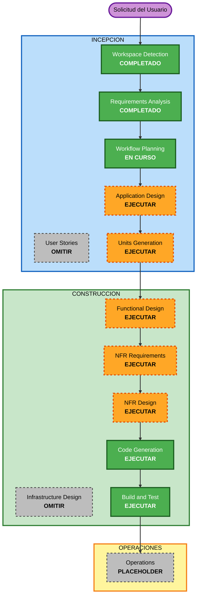

# Plan de Ejecución — Agente de Fútbol

**Proyecto**: Agente de planificación de entrenamientos de fútbol (macro→meso→sesión)
**Tipo**: Greenfield
**Fecha**: 2026-11-07

---

## Resumen del Análisis

### Evaluación de Impacto
- **Cambios para el usuario**: Sí — producto nuevo de cara al entrenador (web local + chat).
- **Cambios estructurales**: Sí — arquitectura nueva por capas (motor de periodización compartido + capa de dominio fútbol + interfaz).
- **Modelos de datos**: Sí — macrociclo, mesociclo, microciclo, sesión, ejercicio, formato de fútbol, adaptaciones, biblioteca, historial.
- **Cambios de API/contratos**: Sí — contrato interno entre el motor, la capa de fútbol y la interfaz; más una posible interfaz al LLM.
- **Impacto NFR**: Sí — operación offline, motor determinista, núcleo desacoplado para escalar, gestión de secretos del LLM.

### Evaluación de Riesgo
- **Nivel de riesgo**: Medio — es un sistema nuevo con varios componentes y lógica de dominio no trivial (periodización encadenada, diagramas), pero local, de un solo usuario y con rollback trivial (es código nuevo, sin producción que romper).
- **Complejidad de rollback**: Fácil (proyecto nuevo).
- **Complejidad de pruebas**: Moderada — la coherencia macro→meso→sesión conviene verificarla (encaja con PBT parcial).

---

## Visualización del Flujo



### Alternativa en texto (por si el diagrama no se renderiza)
```
INCEPCION:
  Workspace Detection ....... COMPLETADO
  Requirements Analysis ..... COMPLETADO
  User Stories .............. OMITIR
  Workflow Planning ......... EN CURSO
  Application Design ........ EJECUTAR
  Units Generation .......... EJECUTAR
CONSTRUCCION (por cada unidad):
  Functional Design ......... EJECUTAR
  NFR Requirements .......... EJECUTAR
  NFR Design ................ EJECUTAR
  Infrastructure Design ..... OMITIR
  Code Generation ........... EJECUTAR
  Build and Test ............ EJECUTAR (tras todas las unidades)
OPERACIONES:
  Operations ................ PLACEHOLDER
```

---

## Etapas a Ejecutar / Omitir

### INCEPCIÓN
- [x] Workspace Detection — COMPLETADO (Greenfield)
- [x] Requirements Analysis — COMPLETADO (aprobado)
- [ ] User Stories — **OMITIR**
  - **Razón**: Usuario único (tú, el entrenador). No hay múltiples personas ni equipos que requieran historias formales. Los requisitos ya capturan los flujos de uso. (Se puede añadir si lo prefieres.)
- [x] Workflow Planning — EN CURSO
- [ ] Application Design — **EJECUTAR**
  - **Razón**: Hay que definir los componentes nuevos y sus responsabilidades: motor de periodización (compartido), capa de dominio fútbol, generador de diagramas, persistencia, interfaz web+chat, conector LLM. Esta etapa establece la arquitectura por capas (RNF-1, RNF-7).
- [ ] Units Generation — **EJECUTAR**
  - **Razón**: El sistema se descompone naturalmente en varias unidades de trabajo (ver abajo). Conviene estructurarlo para construir y aprobar por partes.

### CONSTRUCCIÓN (por cada unidad)
- [ ] Functional Design — **EJECUTAR**
  - **Razón**: Lógica de dominio no trivial: modelos de datos (ciclos, sesión, ejercicio), reglas de periodización, coherencia entre niveles.
- [ ] NFR Requirements — **EJECUTAR**
  - **Razón**: Falta fijar el stack tecnológico (P9 delegada al asistente) y confirmar NFRs (offline, determinismo, desacople).
- [ ] NFR Design — **EJECUTAR**
  - **Razón**: Incorporar los patrones de los NFR (frontera lógica↔interfaz, conector LLM opcional, formato de persistencia en disco).
- [ ] Infrastructure Design — **OMITIR**
  - **Razón**: Agente local, sin nube ni infraestructura desplegada. Las extensiones de Seguridad y Resiliencia están desactivadas. (Se activará cuando se escale a web.)
- [ ] Code Generation — **EJECUTAR** (siempre)
  - **Razón**: Implementación real del agente.
- [ ] Build and Test — **EJECUTAR** (siempre)
  - **Razón**: Construir, ejecutar pruebas (incl. PBT parcial para el motor determinista) y verificar.

### OPERACIONES
- [ ] Operations — PLACEHOLDER (futuro: despliegue web/monitorización al escalar).

---

## Unidades de Trabajo Propuestas (módulos de desarrollo)

> Propuesta preliminar; se formaliza en la etapa de Units Generation. Orden pensado para entregar valor pronto y respetar dependencias.

1. **U1 — Motor de Periodización (núcleo compartido)**
   Modelos de ciclos (macro/meso/micro/sesión), fases, distribución de cargas, encadenamiento coherente. Determinista, sin nada específico de fútbol. Es la pieza reutilizable (RNF-7). *Base de todo.*

2. **U2 — Capa de Dominio Fútbol**
   Formatos (11/7/sala/ciegos) como configuración, modelo de ejercicio/tarea, biblioteca de ejercicios, y el **módulo activable de adaptaciones de fútbol adaptado** (RF-7, RF-8, RF-9). Depende de U1.

3. **U3 — Generación de Diagramas y Gráficas**
   Diagramas esquemáticos de cancha para ejercicios (prioritario) y gráficas de carga (secundario) (RF-5). Depende de U2.

4. **U4 — Persistencia y Exportación**
   Guardado en disco (historial + biblioteca), formato editable interno y exportación a PDF (RF-6, RF-9, RNF-6). Depende de U2/U3.

5. **U5 — Interfaz Web Local + Chat + Conector LLM**
   App web local con formularios y chat (RF-2, RF-3), motor de entrada doble (parámetros + entrevista), conector LLM opcional con gestión de API key (RF-10, RNF-2, RNF-3). Orquesta U1–U4.

6. **U6 — Seguimiento Individual por Deportista** *(nueva — a confirmar A vs B)*
   Ficha por jugador/a con observaciones y seguimiento, enlazada a la planificación. Basada en la metodología FMF Manual 1 (Asesoramiento Táctico Individual: Potenciar / Mejorar / Eliminar, fundamentos por mes, estructuras del futbolista) y en el roster por demarcación visible en la plantilla real de sesión. Depende de U2 (demarcaciones, dominio) y se integra con el PlanningService (observaciones ligadas a sesiones/microciclos).
   - **DECISIÓN: Opción A** — incluido en la **v1**, integrado al núcleo. Incluye objetivos individuales por jugador/a (Potenciar/Mejorar/Eliminar), y la sesión integra además cargas, materiales y volumen (ver nota de plantilla mejorada).

---

## Decisiones de Diseño (D1–D6, Application Design)

| ID | Tema | Decisión |
|----|------|----------|
| D1 | Arquitectura | Modular por **capas ligeras**: dominio aislado (motor + fútbol) + adaptadores (UI, LLM, disco), sin ceremonia pesada de puertos/adaptadores. |
| D2 | Almacenamiento | **JSON en disco** primero (RNF-6), repositorio tras una interfaz para poder **migrar a SQLite** al escalar. |
| D3 | Diagramas | **SVG generado** (nítido en pantalla y PDF; ideal para diagramas por zonas/momentos y gráficas de carga). |
| D4 | Modelos de periodización precargados | **5 modelos**: (1) Tradicional/lineal, (2) Por bloques, (3) ATR, (4) **Periodización Táctica** (Frade), (5) **Entrenamiento Estructurado** (Seirul·lo). Los dos últimos = metodología de los manuales FMF del usuario. Validado con literatura reciente. Motor abierto a añadir más. |
| D5 | Conector LLM | **Genérico/enchufable**: nube (OpenAI/Anthropic) o local (Ollama), opcional, con API key por configuración (RNF-3). |
| D6 | Idioma del contenido | **Bilingüe** (español/inglés seleccionable). i18n desde el diseño: catálogos de contenido y UI con claves de traducción. |

## Base de Conocimiento Metodológica (manuales FMF)

El usuario aportó 7 manuales de la Licencia PRO FMF / MBP School of Coaches como **base de conocimiento privada** (copyright FMF; uso local/personal; se codifica la metodología, no se redistribuyen páginas literales):

- **C1** Nivel de alto rendimiento → fragmentación del juego (dinámicas/fases/momentos) = vocabulario de diagramas y modelo de juego.
- **C2** Metajuego y estructuras → estructuras del futbolista/equipo.
- **C3** Planificación plurianual, macrociclos y mesociclos → **alimenta U1** (períodos, mesociclos, %cargas, tipos de micro).
- **C4** Microciclo de entrenamiento → microciclos tipo (1/2 partidos), 4 fases, 23 parámetros.
- **C5** Sesión de entrenamiento → **6 fases de sesión** + relación vertical.
- **C6** Estrategias didácticas II → catálogo de tareas (juegos de posición, chunks, juegos de línea, SSP) + tabla fase×bloque×estrategia.
- **C9** Comunicación → módulo opcional (no núcleo).

**Referencia de salida**: plantilla real de sesión (América U19 Fem) analizada en `inception/application-design/session-output-reference.md` — guía del formato de salida de sesión, mejorable.

**Reglas metodológicas ancladas**: `knowledge-base/metodologia-fmf.md` — especificación destilada de los manuales FMF (C1–C6, C9) con trazabilidad por manual. Es la **fuente directa** para el diseño de cada unidad en Construcción (duraciones de períodos, tipos de microciclo y % de carga, 6 fases de sesión, tabla fase×bloque×estrategia, fundamentos, momentos para diagramas, Potenciar/Mejorar/Eliminar para U6).

---

## Cronograma Estimado (orientativo)
- **Etapas INCEPCIÓN restantes**: Application Design, Units Generation.
- **Etapas CONSTRUCCIÓN**: diseño + código por cada unidad (U1→U5), luego Build and Test global.
- **Duración**: depende del ritmo de trabajo conjunto y de las aprobaciones por etapa; se irá refinando.

## Criterios de Éxito
- **Objetivo principal**: Agente local que encadena macro→meso→sesión con diagramas, para fútbol (todas las modalidades), editable y exportable a PDF.
- **Entregables clave**: motor de periodización reutilizable, capa de fútbol, diagramas, persistencia, interfaz web+chat.
- **Puertas de calidad**: coherencia verificable entre niveles (PBT parcial), operación offline, núcleo desacoplado de la interfaz.
